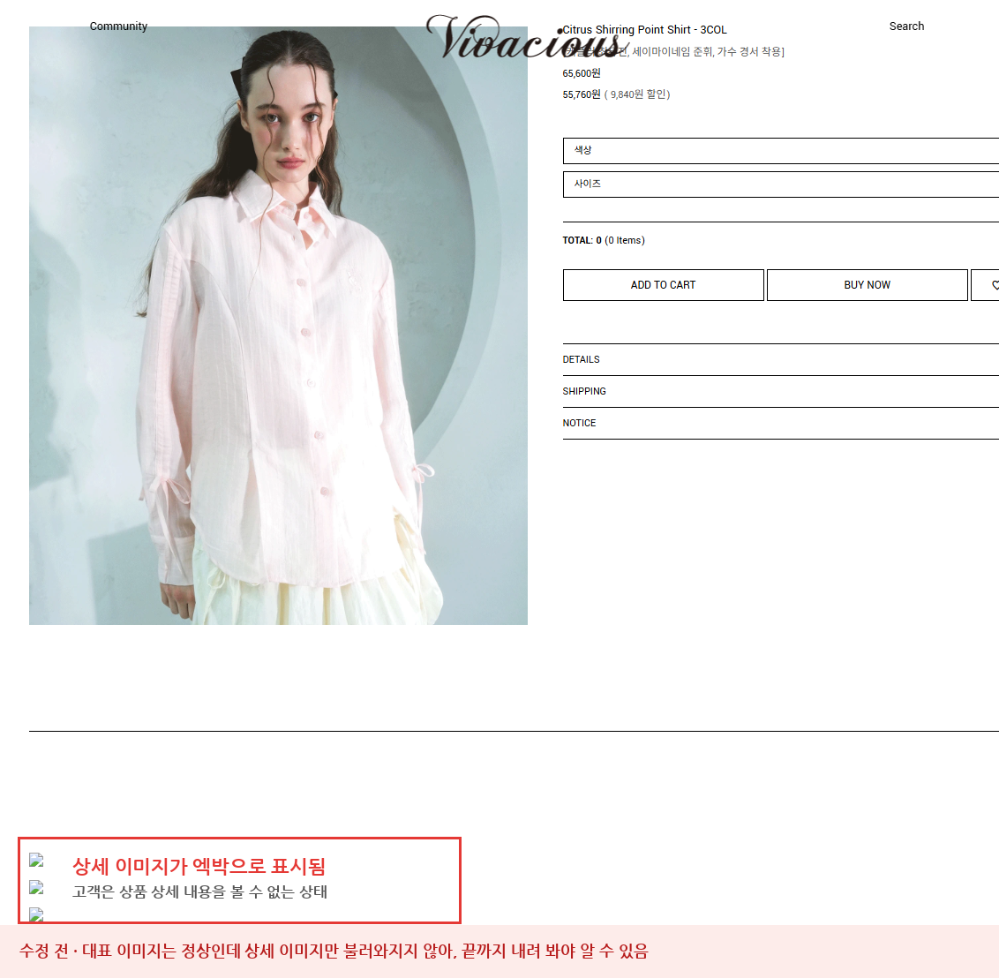
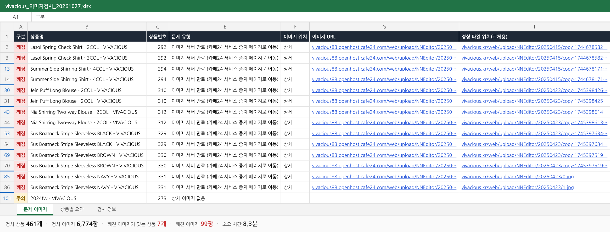
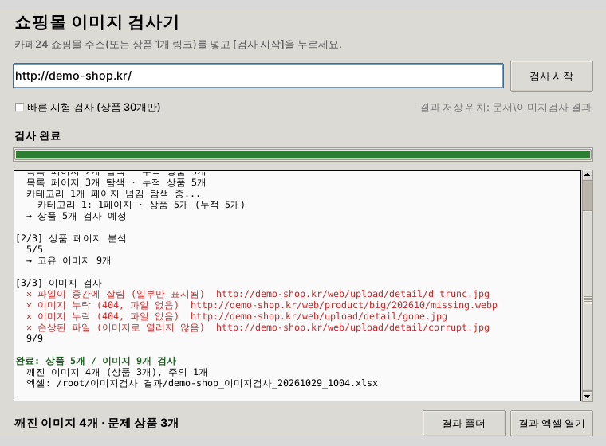

# 쇼핑몰 이미지 검사기 (Shop Image Checker)

카페24 쇼핑몰의 **모든 상품 페이지를 자동으로 돌면서 깨진 상품 이미지를 찾고, 결과를 엑셀로 정리**하는 도구입니다.
엑박, 누락, 업로드 중 잘린 파일처럼 눈으로 일일이 확인하기 어려운 문제를 한 번에 찾아냅니다.



<br>

## 1. 왜 만들었나요?

### 문제 상황

쇼핑몰을 운영하다 보면 상품 상세페이지의 이미지가 **어느 순간 엑박으로 바뀌어 있는** 경우가 생깁니다.
고객이 상세 이미지를 보지 못하면 구매로 이어지지 않지만, 운영하는 쪽에서는 잘 알아차리지 못합니다.

- **상품이 수백 개, 이미지는 수천 장**이라 하나하나 열어 보는 데 시간이 너무 많이 걸립니다.
- 상세 이미지는 스크롤해야 불러와지기 때문에, 페이지를 열어도 **끝까지 내려 보지 않으면** 깨진 걸 놓칩니다.
- 업로드 중 끊겨 **아래쪽만 잘린 이미지**는 엑박도 뜨지 않아 눈으로 찾기가 더 어렵습니다.
- 예전에는 잘 보이던 이미지가 **서버 주소가 만료되면서** 한꺼번에 깨지기도 합니다.

### 실제로 겪은 사례

vivacious.kr의 상품 7개는 상세 이미지가 모두 엑박으로 보이고 있었습니다.
원인을 확인해 보니, 이 상품들의 상세설명이 이미지를 쇼핑몰 주소(`vivacious.kr`)가 아니라
**예전 카페24 임시 주소(`vivacious88.openhost.cafe24.com`)**에서 불러오고 있었습니다.
이 임시 주소가 만료되면서 이미지 대신 카페24의 **서비스 중지 페이지**가 응답되고 있었던 것입니다.

이렇게 겉으로는 정상처럼 보이는 상품들 사이에 숨어 있는 문제를 **사람 대신 빠짐없이 찾기 위해** 이 도구를 만들었습니다.

<br>

## 2. 어떻게 해결하나요?

### 동작 방식


1. **상품 수집**: 메인과 카테고리 목록을 페이지 넘김까지 모두 돌면서 상품 링크를 모읍니다.
2. **이미지 추출**: 상품 페이지에서 대표 이미지, 추가 이미지, 상세 이미지를 뽑아냅니다. 스크롤할 때 뒤늦게 불러오는 이미지(`ec-data-src`, `data-src` 등)도 빠짐없이 찾습니다.
3. **실제로 열어 보기**: 주소가 살아 있는지만 보는 것이 아니라, **파일을 내려받아 끝까지 디코딩**합니다. 그래서 엑박이 뜨지 않는 '잘린 파일'까지 찾아냅니다.
4. **교체용 파일 찾기**: 다른 주소에 있는 이미지가 깨졌다면, 쇼핑몰 주소에 같은 파일이 남아 있는지 확인해 엑셀에 적어 줍니다.

### 찾아내는 문제

| 구분 | 문제 | 설명 | 해결 방법 |
|---|---|---|---|
| 깨짐 | 이미지 서버 만료 | 예전 임시 주소(`○○.openhost.cafe24.com`)로 올린 이미지 | 상세설명의 이미지 주소를 쇼핑몰 주소로 교체 |
| 깨짐 | 이미지 누락 (404) | 파일이 삭제되어 엑박으로 보임 | 이미지 다시 업로드 |
| 깨짐 | 파일이 중간에 잘림 | 업로드·전송 중 끊겨 일부만 표시됨 | 원본으로 다시 업로드 |
| 깨짐 | 손상된 파일 / 0바이트 | 이미지로 열리지 않음 | 원본으로 다시 업로드 |
| 깨짐 | 오류 페이지 응답 | 이미지 자리에 HTML 오류 페이지가 옴 | 이미지 주소 확인 |
| 주의 | 하단 회색 띠 | 잘린 채로 다시 저장된 이미지 의심 | 상품 페이지에서 눈으로 확인 |
| 주의 | 상세 이미지 없음 | 상세 이미지가 하나도 없는 상품 | 의도한 것인지 확인 |

<br>

## 3. 실제 적용 결과

vivacious.kr 전체 상품을 대상으로 검사했습니다. (2026년 10월 27일)

| 항목 | 결과 |
|---|---|
| 검사한 상품 | **461개** |
| 검사한 이미지 | **6,774장** |
| 소요 시간 | **약 8분** |
| 깨진 이미지가 있는 상품 | **7개** |
| 깨진 이미지 | **99장** (모두 '이미지 서버 만료') |



> 문제 상품마다 상위 2줄만 보이도록 줄을 걸러 낸 화면입니다.

- 깨진 99장 모두 **같은 원인(임시 주소 만료)**이라는 것을 바로 알 수 있었습니다.
- 99장 모두 쇼핑몰 주소에 같은 파일이 남아 있어, `정상 파일 위치(교체용)` 칸에 교체할 주소가 채워졌습니다.
- 결과 엑셀의 목록을 보고 7개 상품의 상세 이미지를 카페24 관리자에서 직접 다시 등록한 뒤, **재검사한 결과 깨진 이미지 0장**을 확인했습니다. (2026년 10월 29일)

> 이 도구는 **문제를 찾아 목록으로 정리하는 역할**까지 합니다. 이미지 교체나 재등록은 카페24 관리자에서 직접 합니다.

사람이 461개 상품을 하나씩 끝까지 스크롤하며 확인했다면 반나절 넘게 걸렸을 작업을 8분 만에 끝냈습니다.

<br>

## 4. 사용 방법

### 방법 1. 프로그램(.exe)으로 쓰기 — 개발자가 아닌 분께 권장



> 예시 쇼핑몰로 실행한 화면입니다. 깨진 이미지는 빨간색으로 바로 표시됩니다.

**처음 한 번만: 실행 파일 만들기**

1. 이 저장소를 내려받습니다. (`Code` → `Download ZIP` → 압축 풀기)
2. 윈도우 PC에 [Python](https://www.python.org/downloads/)을 설치합니다. 설치 첫 화면에서 **"Add python.exe to PATH"를 꼭 체크**하세요.
3. `build_exe.bat`을 더블클릭합니다. 1~3분 뒤 같은 폴더에 `ShopImageChecker.exe`가 생깁니다.
4. 팀원에게는 `ShopImageChecker.exe`와 [`docs/사용방법.txt`](docs/사용방법.txt) 두 파일만 전달하면 됩니다. **받는 사람은 파이썬을 설치할 필요가 없습니다.**

**검사하기**

1. `ShopImageChecker.exe`를 더블클릭합니다.
2. 쇼핑몰 주소(예: `https://vivacious.kr/`)나 상품 1개의 링크를 붙여넣습니다.
3. **[검사 시작]**을 누릅니다. 처음이라면 **[빠른 시험 검사]**를 체크해 상품 30개만 먼저 돌려 보세요.
4. 검사가 끝나면 엑셀을 열지 묻습니다. 결과는 `문서\이미지검사 결과` 폴더에 날짜별로 저장됩니다.

> 처음 실행할 때 "Windows의 PC 보호" 창이 뜨면 **[추가 정보] → [실행]**을 누르세요. 코드 서명이 없는 사내 프로그램이라 나오는 안내입니다.

### 방법 2. 명령어로 쓰기

```bash
pip install -r requirements.txt

# 쇼핑몰 전체 검사
python shop_image_check.py https://vivacious.kr/

# 상품 1개만 검사
python shop_image_check.py "https://vivacious.kr/product/lasol-spring-check-shirt-2col/292/"

# 상품 30개만 시험 검사
python shop_image_check.py https://vivacious.kr/ --limit 30
```

윈도우에서는 `run_check.bat`을 더블클릭해도 됩니다.

| 옵션 | 기본값 | 설명 |
|---|---|---|
| `--limit` | 0 (전체) | 검사할 최대 상품 수 |
| `--workers` | 6 | 동시에 보내는 요청 수 (서버 부담이 걱정되면 낮추세요) |
| `--delay` | 0.2 | 목록 페이지 요청 간 대기 시간(초) |
| `--out` | 자동 | 결과 엑셀 파일 이름 |

### 결과 엑셀 구성

| 시트 | 내용 |
|---|---|
| 문제 이미지 | 구분(깨짐/주의), 상품명, 상품번호, 상품 링크, 문제 유형, 이미지 위치, 이미지 URL, 교체용 주소 |
| 상품별 요약 | 전체 상품의 이미지 수와 정상 / 주의 / 깨짐 결과 |
| 검사 정보 | 검사 시각, 소요 시간, 검사한 상품·이미지 수, 문제 건수 |

<br>

## 5. 파일 구성

| 파일 | 설명 |
|---|---|
| `shop_image_check.py` | 검사 엔진 (상품 수집 → 이미지 검사 → 엑셀 작성) |
| `image_checker_app.py` | 화면(GUI) 프로그램 |
| `build_exe.bat` | 윈도우 실행 파일(.exe) 만들기 |
| `run_check.bat` | 명령어 버전을 더블클릭으로 실행 |
| `docs/사용방법.txt` | 팀원 배포용 사용 설명서 |
| `generic_image_checker.py` | 카페24가 아닌 일반 사이트용 간단 검사기 (CSV·HTML 리포트) |

<br>

## 6. 앞으로 추가하고 싶은 기능

- **깨진 이미지 자동 교체**: 지금은 결과 목록을 보고 카페24 관리자에서 직접 이미지를 다시 등록합니다. 앞으로는 다음 두 단계로 자동화할 계획입니다.
  - **주소 만료 이미지**: 쇼핑몰에 같은 파일이 이미 남아 있으므로, 상세설명의 이미지 주소만 교체용 주소로 바꿉니다.
  - **누락·손상 이미지**: PC나 클라우드 공유 폴더에 있는 원본 이미지를 찾아 해당 상품에 다시 올립니다. 이를 위해 폴더·파일 이름에 상품번호를 넣는 규칙을 정해 파일과 상품을 짝지을 예정입니다.
- **수정 전 확인 단계**: 판매 중인 상품 페이지를 고치는 작업이므로, "이 상품에 이 파일을 올리겠다"는 목록을 먼저 보여 주고 확인을 받은 뒤 실행합니다.
- **카페24 연동 방식 검토**: 카페24 개발자 API를 쓸지, 관리자 화면을 브라우저로 자동 조작할지 검토합니다.

<br>

## 7. 한계

- **카페24 쇼핑몰 구조**에 맞춰져 있습니다. 다른 플랫폼에서는 `generic_image_checker.py`를 쓰세요.
- 자바스크립트로 화면을 그리는 페이지는 이미지가 수집되지 않을 수 있습니다.
- 모델 머리가 잘린 사진처럼 **파일은 정상인데 구도가 잘못된 사진**은 판단하지 못합니다.
- '하단 회색 띠'는 의심 표시입니다. 회색 배경 촬영 사진은 걸러 내도록 했지만, 최종 확인은 눈으로 해 주세요.
